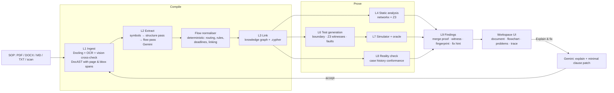

# PolicyC architecture

> **Gemini translates, the engine proves.**
> Gemini turns a policy document into a process model. Everything that is reported as a *finding* is
> produced by deterministic code (graph search, the Z3 solver, a simulator) and carries a witness
> you can re-run. Gemini is never asked "what is wrong with this SOP?". The findings are only as good
> as the reading, so every element cites its clause and anything the system infers is marked.



## What each side does

| Gemini (language) | Deterministic engine (proof) |
|---|---|
| Reads clauses into steps, roles, decisions with conditions and a quote | Reachability, dead ends, loops, mandatory-order (`ST001-003, ST008`) |
| Reads the whole document for exceptions, ordering rules, deadlines (flow pass) | Z3: missing branch, overlapping rules over numbers, enums, booleans (`ST004/ST005`) |
| Cross-checks scanned pages by vision (OCR is never trusted alone) | Segregation of duties: can the requester be routed to a step only they could perform? (`RS004`) |
| Explains a proven finding in plain language | Deadline arithmetic along every path (`TM002`), broken references (`XD001`) |
| Proposes a minimal clause rewrite (validated against the document text) | Executes boundary / witness / fault scenarios and applies an oracle (`EX001/EX002`) |

## Why the extraction is trustworthy

1. **Every element cites the clause** it came from (`source_spans`, verified by string equality).
2. **Round-trip check**: the IR is translated back to words and compared with the section.
3. **Flow normaliser**: a deterministic repair pass between the LLM and the checks. It reads
   "below INR 10,000 / above INR 10,000 / submitted by a manager" into one routing decision,
   moves standing rules ("no person may approve their own claim") out of the flow, turns
   "within 7 calendar days of submission" into an end-to-end deadline, and links the flow in
   document order. It does **not** fix the SOP: a clause that nothing triggers stays unreachable, a
   hand-off to a missing section stays a dead end, and a gap at exactly 10,000 stays a gap.
   Everything it adds is flagged *inferred* (dashed in the UI).
4. **Guards on LLM output**: ids must exist, decisions that would create a loop are discarded,
   a "must happen before" rule cannot hang on an exception clause, per-step limits are not
   mistaken for end-to-end deadlines.

## Fix → recompile → regression

`Explain & fix` asks Gemini for a minimal rewrite of the clause text (the original text must be found
verbatim in the document, otherwise the patch is dropped; a deterministic fallback handles
"below/above X" gaps). `Accept` writes the patched text into a new document revision and compiles
it. Findings carry a stable *fingerprint* (code + clause + rule pair), so the regression view shows
**fixed · new · remaining** between revisions.

## Deployment

```
Browser ── Firebase Hosting (static React app, Google sign-in via Firebase Auth)
              │  HTTPS, Authorization: Bearer <Firebase ID token>
              ▼
        Render free web service (Docker, lightweight: FastAPI + Z3, SQLite, no Docling)
              │  seeded with precomputed demo runs on every cold start
              ▼
        Gemini API (AI Studio key)
```

See [deploy/DEPLOY.md](../deploy/DEPLOY.md).
